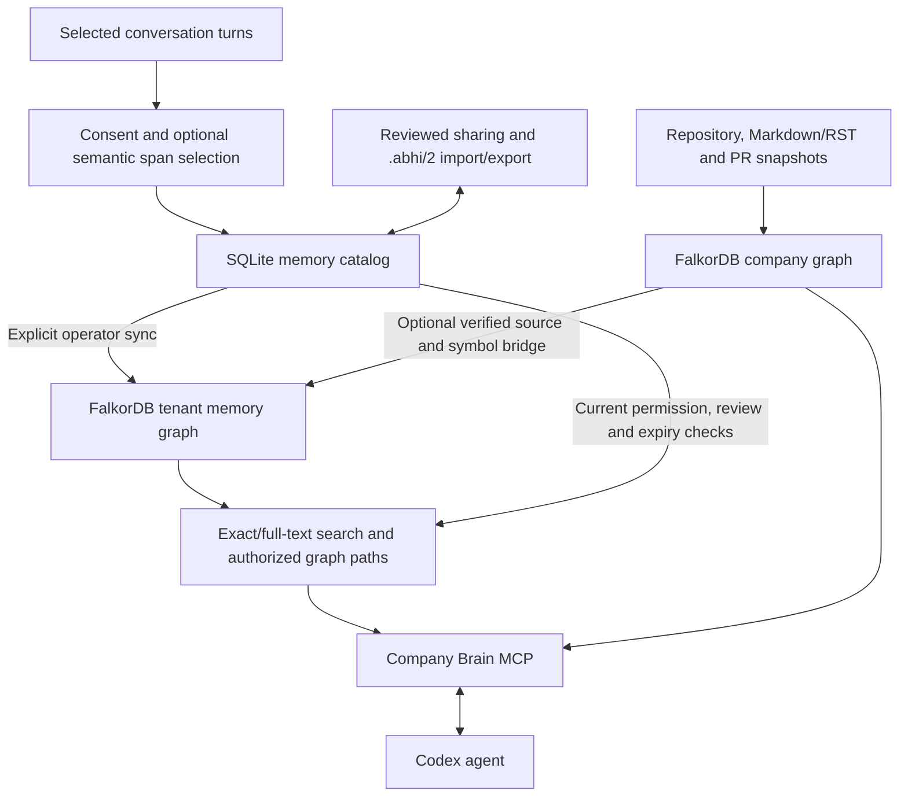

# Company Brain

A local MCP server that connects a planned code change to incoming callers,
source-backed constraints and maintainer evidence in FalkorDB. Codex remains the
code-editing agent. An opt-in memory extension connects personal, team and company
knowledge through scoped graph paths. Source prose is untrusted evidence;
remembering something creates a proposal, never an approved rule.

## Current architecture and status

The default server exposes five company-code tools. Configuring a memory catalog
adds `memory_search` and `memory_propose`; enabling native memory graphs adds
`memory_graph`, for eight tools in total.



SQLite remains authoritative for records, permissions, reviews and audit history.
FalkorDB stores the projected memory topology in a separate tenant namespace and
performs native exact/full-text retrieval and bounded graph traversal. This route
requires **no embedding model**. The explicit catalog backend retains optional
local vectors stored and scored in SQLite. Projections must be refreshed by an
operator; stale or unavailable native retrieval is reported without silent fallback.

| Component | Implemented behavior |
| --- | --- |
| Personal memory | Exact-consent selected-turn import; deterministic or opt-in model-selected durable spans, literal entities and private proposals |
| Team/company sharing | Selected reviewed records, current scope grants and destination proposals |
| Portable memory | `.abhi/2` selected current topology and optional reviewed assertions, with validated import/export round trips |
| Memory relationships | Separately reviewed, version-pinned `UPDATES`, `EXTENDS` and `RELATES_TO` assertions |
| Native memory graph | Brain, person, team, memory, source, entity and version nodes; authorized cross-scope citation paths |
| Graphify extractor | Pinned optional structural ingestion into revision-pinned advisory evidence; separate from authoritative Python calls |
| Graph viewer | Local fixed-principal API and clickable authorized shared-memory slices |
| Company bridge | Exact verified citations and unambiguous lexical code identifiers connected to existing company evidence |
| Native retrieval | Exact/full-text seeds, scope-safe ranking, up to four graph hops, citations and supporting paths |

See [memory architecture](docs/memory-architecture.md),
[three-brain graphs](docs/three-brain-graphs.md),
[reviewed relationships](docs/memory-relationships.md),
[company bridge](docs/memory-company-bridge.md) and
[native retrieval](docs/falkor-memory-retrieval.md) for contracts and limitations.

The [Graphify and three-brain integration milestone](docs/graphify-three-brain-integration.md)
adds a real structural runtime adapter, semantic span selection, bounded native
frontier traversal, a permission-aware local viewer and a freshly verified guided
Codex run. The runner's `--memory-graph` option enables search and inspection;
write/administration tools remain excluded.

**Still planned:** Graphify's semantic model pass, the FalkorDB GraphRAG SDK/PDF
pipeline, full-history graph portability, a hosted multi-user graph experience,
and broader agent evaluation. Arbitrary semantic company-concept resolution is
still unbuilt; automatic correction proposals require an explicit correction and
an unambiguous code identifier. Hosted identity, application encryption,
distributed synchronization and production-scale retrieval remain outstanding.
See the [roadmap](docs/roadmap.md).

## Validation and measured results

The current full isolated memory/graph suite passed **267 tests**, including real
FalkorDBLite graph and process-lifecycle checks. Ruff and the publication scan
pass. The portability workflow includes live Docker graph/memory regression
checks and installs the optional Graphify extractor there. CI for these new changes
has not run yet.

A small synthetic retrieval comparison separates natural-language queries from
three deliberately authored graph-path acceptance cases:

| Retrieval backend | Natural-language Hit@3 (9 queries) | Graph-path Hit@3 (3 queries) |
| --- | --- | --- |
| Catalog exact/full-text | 6/9 | 0/3 |
| Native FalkorDB exact/full-text + paths | 6/9 | 3/3 |
| Catalog with optional local vectors | 8/9 | 1/3 |

These fixtures show complementary strengths: graph links recover related evidence,
while vectors help paraphrases. They do not establish production quality, a speed
advantage or improved coding outcomes. See the
[retrieval report](docs/falkor-memory-evaluation.json),
[vector comparison](docs/falkor-memory-vector-comparison.json) and
[methodology](docs/falkor-memory-retrieval.md).

The new [guided three-brain agent run](docs/three-brain-agent-verification.json)
retrieved personal memory, inspected authorized team/company paths and a verified
source before editing a synthetic retry function. Its patch passed **15 independent
oracle cases** and its own regression tests; another developer's private canary
was excluded. This is an integration demonstration, not a baseline comparison.

The earlier approved-v5 coding comparison completed **3 baseline + 3 graph
sessions**: every run passed **12/12 independent oracle cases** and its selected
upstream suite. Both conditions succeeded 3/3; **no correctness advantage was
observed**. These historical company-graph experiments do not evaluate the new
three-brain memory workflow. See [results and limitations](docs/v5-evaluation.md).

The preserved v5/Browser verification passed 144 tests; the earlier
[memory verification report](docs/memory-verification.md) records its separate
183-test milestone. The [agent demonstration](docs/agent-demo-results.md),
[runner](docs/agent-workflow.md) and [v5 reproduction](docs/v5-reproduction.md)
retain the historical evidence and reproduction instructions. Human approval
remains a separate interactive step.

## Docker-free local setup (verified)

See [Lite integration results and commands](docs/lite-integration.md). Install
`libomp`, run `uv sync --frozen --extra lite --python 3.12`, and keep one owner running:

```sh
.venv/bin/python scripts/run_lite.py --db "$PWD/data/runtime/lite/brain.rdb"
```

Sync and MCP connect to that engine through the existing loopback configuration.
Keep the entire ignored runtime directory for persistence. No paid Cloud resource
or global Codex configuration change is required.

## Enable optional memory graphs

Copy `config/brain.memory.example.yaml` to an ignored local config and set the
absolute checkout/catalog paths, tenant, principal and engine port. Uncomment
`memory_graph_enabled: true`; omit `embedding_model_dir` for native retrieval.
Use a separate runtime/catalog rather than the preserved approved demo database.

Follow [memory operations](docs/memory-operations.md) to import consented turns,
review records and configure sharing. After those records exist, refresh the
projection and query it:

```sh
.venv/bin/python -m brain.memory_cli --config /ABSOLUTE/PATH/memory.local.yaml \
  sync-graph --brain private:alice
.venv/bin/python -m brain.memory_cli --config /ABSOLUTE/PATH/memory.local.yaml \
  search --query 'upload replay' --backend falkor
```

Replace `alice` with the configured principal. Launch MCP with the same
`BRAIN_CONFIG`. In graph mode, `memory_search` defaults to FalkorDB; select
`backend="catalog"` explicitly to compare the optional vector baseline. Company
paths require current company access and `sync-graph --include-company`, followed
by search with `--include-graph`. See [portable exchange](docs/abhi-format.md) for
selected `.abhi/2` export/import.

## Graphify, semantic extraction and graph viewing

```sh
uv sync --frozen --extra lite --extra graphify --python 3.12
# First sync a clean configured checkout, then ingest selected tracked code:
uv run python -m brain sync
uv run --extra graphify python -m brain ingest-graphify src/example.py
# Configure memory_graph_enabled and the trusted viewer principal first:
uv run python -m brain.memory_viewer --config /ABSOLUTE/PATH/memory.local.yaml
```

The viewer prints a local session URL. It binds to loopback, requires a bearer
session token and retrieves every graph slice through current catalog permissions.
Clicking a member shows authored memory within the selected authorized scopes.
It does not expose their private brain.

Conversation import keeps deterministic extraction by default. Explicitly selecting
`--semantic-model` opts into sending the consented selected turns to the named
Codex model for durable-span/entity selection. Facts and suggested corrections
remain proposals. See the [integration guide](docs/graphify-three-brain-integration.md)
for the exact command, model boundary and reproduction steps.

## Optional Cloud setup (not live-verified)

[Cloud provisioning](docs/cloud-setup.md) and `config/brain.cloud.example.yaml`
remain available. Remote connections require verified TLS and a protected local
password file. Cloud provisioning is deferred while the hackathon uses Lite.

## Alternative Docker setup

Requires Python 3.11+, uv, Git, and a running FalkorDB 4.14.7 server. Python
packages are pinned in uv.lock (tested with Python 3.12).

```sh
uv sync --frozen
docker compose up -d
cp config/brain.example.yaml config/brain.local.yaml
# Edit repo_root, repo_id, repo_url and principal in the local config.
export BRAIN_CONFIG="$PWD/config/brain.local.yaml"
uv run python -m brain sync
uv run python -m brain.mcp_server
```

With Podman, start an existing machine and use:

```sh
podman run -d --name company-brain-db \
  -p 127.0.0.1:6379:6379 -p 127.0.0.1:3000:3000 \
  -v company-brain-data:/data docker.io/falkordb/falkordb:v4.14.7
```

STDIO waits for MCP input; it does not print a success message. Configure an MCP
client to launch the absolute `.venv/bin/python` path with arguments
`["-m", "brain.mcp_server"]` and an absolute `BRAIN_CONFIG` environment value.
Set `PYTHONPATH` to the absolute `src` directory in the MCP launcher as well, so
module discovery remains reliable even if an editable-install path file is ignored.
The server discovers its configured tools even while the database is down; dependent
calls return `status: unavailable`.

The local development checkout at `.checkouts/requests` is ignored. Recreate it:

```sh
mkdir -p .checkouts
git clone https://github.com/psf/requests.git .checkouts/requests
git -C .checkouts/requests checkout 611c6162cbc4ac2020a2f91c7cfa4f3abf9bbb60
```

## Tools and model

| Tool | Purpose |
| --- | --- |
| get_context | Exact ID / bounded full-text seeds, then connected paths |
| trace_decision | Lifecycle, original evidence, replacement history |
| find_owner | Explicit file CODEOWNERS, otherwise inferred Git maintainers |
| check_change | Intended symbols, incoming callers, constraints and source-backed file history |
| remember | A new non-binding proposal in org or configured private scope |

Optional memory tools:

| Tool | Enabled by | Purpose |
| --- | --- | --- |
| memory_search | Memory catalog configuration | Scoped native or catalog retrieval with citations |
| memory_propose | Memory catalog configuration | Create a non-binding memory proposal |
| memory_graph | `memory_graph_enabled: true` | Browse bounded authorized memory/evidence paths |


The key relationship is `(caller)-[:CALLS]->(target)`. Decisions constrain symbols;
Sources preserve provenance. Files declare Symbols, Projects contain Files,
People author Commits that modify Files. CODEOWNERS edges carry the original rule.
Public issue/PR/comment snapshots link to Source nodes. No invented organization
hierarchy is added. Git author names are not automatically merged with GitHub users.

```cypher
MATCH path=(caller:Symbol)-[:CALLS*1..2]->(target:Symbol)
WHERE target.uid IN $ids
RETURN [n IN nodes(path) | n.uid] AS path
LIMIT 100
```

The service then queries decisions for the complete bounded set of targets and
callers in one batch. `must_preserve` requires active, human-approved constraint
metadata, source evidence, a matching approved revision and a clean checkout.
Proposals and stale evidence appear in `review`. Both contain IDs and metadata;
prose stays in `untrusted_source_excerpts`.

`check_change` also follows recorded historical Issue/PR → File associations
for the target and its bounded incoming callers, including PR references to
issues. It can return original source bodies and discussion without a Decision.
These file-level links and untrusted reference mentions are advisory evidence,
not symbol constraints or proof that an issue was fixed. Missing call edges do
not prove missing dependencies. Overflow is disclosed through `status="incomplete"`
and `truncated`, including the final union of context file associations.

## Evidence and operator approval

`data/sources/manifest.json` records 21 public Requests issues/PRs, collection time,
pinned code revision, URLs, content hash and pagination omissions. These are real
public snapshots, not synthetic chat messages. Requests is Apache-2.0 licensed;
public discussion text retains its original attribution and applicable terms.
Snapshot ingestion is manual:

```sh
uv run python -m brain ingest-snapshots data/sources
```

The CLI supports `list-proposals`, `inspect <id>`, and `approve <id>`. A separate
human-controlled terminal must set `BRAIN_OPERATOR_SESSION=1`, inspect source,
text, subject and any replacement, then type the exact confirmation. **Do not
put this flag in the MCP environment or have the agent approve its own proposal.**
Approval checks and supersession run in one conditional database mutation.

This is an application workflow boundary, not hostile-shell isolation. An agent
with unrestricted shell or database write access can bypass it. The environment
flag is a workflow guard, not a secret credential. The MVP must not be described
as tamper-proof. Private data is routed to a separate configured graph; it is not
protected from database administrators. Browser recordings must show only org_demo.
Browser 2.7.0 attaches to Lite and opens `/graph?graph=org_demo` directly;
see the [verified procedure and initial missing-corpus finding](docs/browser-verification.md).
That Browser inspection found Requests rather than the original eligible corpus. A separate
[reconstructed public-source Browser demo](docs/browser-demo/README.md) now
verifies the document and caller paths and includes sampled Browser footage;
its human-approved D-2 → superseded D-1 path and retained sources are now
verified in Browser. The runbook includes reproduction commands and final footage.

## Verification

```sh
uv run pytest -q
uv run ruff check src tests scripts
# Disposable Lite owner, isolated catalog and full memory/graph/lifecycle suite:
.venv/bin/python scripts/validate_memory_foundation.py
# Only against a local disposable/test database:
BRAIN_TEST_CONFIG=/absolute/path/to/isolated-test.yaml \
  BRAIN_INTEGRATION=1 BRAIN_LITE_TESTS=1 uv run pytest -q
```

The disposable runner requires the `lite` extra installed in the local environment.
Reproduce the synthetic native retrieval benchmark without a model using:

```sh
PYTHONPATH=src .venv/bin/python scripts/benchmark_falkor_memory.py \
  --output "$PWD/data/validation/native-retrieval.json"
```

Unit/contract checks cover poisoning proposals, private routing, scope/path
validation, CODEOWNERS precedence, caller constraints, stale revision behavior,
admin rejection, exact five-tool discovery, and real STDIO launch from another
working directory with the database unavailable. The live suite has now verified
Cypher on the measured Lite engine; mocks alone
do not prove compatibility. Set BRAIN_INTEGRATION=1 and BRAIN_LITE_TESTS=1 to
include the live graph and process-lifecycle checks.

The live suite verifies repository/private graph boundaries, source poisoning,
independent approval, two-hop callers, Issue → PR → File history, explicit
re-exports, stale revisions and sync recovery. Separate-process STDIO tests
verify exactly five tools and real source-backed responses. The publication
workflow scans indexed content and reachable history; it does **not** run pytest.

## Recorded Codex coding experiments

Saved urllib3 #5181 experiments used pin
`a37bc93b65d6bcf00d3dc43d966bab6bd130ecd8`. The first graph attempt's MCP call
was denied and also used an invalid scope; its patch passed 10/12 independent
socket cases and regressed 303 body disposal. An older six-attempt paired batch
completed only three coding sessions; usage limits interrupted the others, and
the completed graph session selected empty private scope. A separate early
guided run retrieved history but passed only 9/12 oracle cases.

Two later graph-only workflow demonstrations each passed 12/12 socket cases
and 131 selected upstream tests. A subsequently frozen matched baseline/graph
pair completed both sessions: **both passed 9/12 socket cases and 131 selected
upstream tests**, with the same failed-tell first-upload regressions. The graph
session retrieved org evidence and checked impact before editing, but reported
that the history did not change its implementation. These are separate protocols;
the successful graph-only runs cannot be treated as comparison wins.

Eligible comparison history included merged #5161/#3780, with solution-revealing
#5181/#5191/#5242 content excluded before execution. Related merged history is
additional information, not evidence of independent discovery. No measured
baseline coding improvement has been demonstrated. The reviewed runner and evaluation code are now integrated on a fresh branch
from the merged backend. A new failed attempt (9/12 oracle cases) and a final
passing graph-aware attempt (12/12) are recorded in
[agent-demo-results.md](docs/agent-demo-results.md). Raw traces and experiment
data stay local and are not publication inputs.

## Remaining release gates

- Browser traversal and human-approved supersession are recorded for the
  [separate reconstructed demo](docs/browser-demo/README.md). Visual verification
  of the frozen v5 experiment graph remains pending; keep these corpora labeled.
- Record a new video using the fresh graph-2 run, real approval/supersession
  evidence, complete comparison table and disclosed retrieval limits.
- Inspect the actual submission form and its required links/declarations.
- On Saturday 17 October, scan the final release history, manually review source
  and binary/video exports, make the repository public, and verify logged-out access.
- Submit by early evening Sunday 18 October, ahead of the 11:59 PM IST deadline.

Broader evaluation and runtime call resolution remain future work. The separate
[Docker demo check](docs/browser-demo/docker-review.md) exercised FalkorDB 4.14.7;
the frozen coding trials used Lite 4.18.3. Neither run certifies other versions.

Static calls cover conservative same-module lexical calls, deterministic direct
imports and explicit Python `from`-import re-export chains, including aliases and
relative imports in repository-root and src layouts. Ambiguous modules, star or
conditional imports, reassignment, re-export cycles, decorated targets, closures,
inheritance and runtime dispatch remain unresolved rather than guessed. Existing
self/cls method edges are heuristic. Dirty checkout detection
is intentionally conservative across the entire repository. Graph queries have
explicit bounds and no offline answer cache. Synchronization is single-operator;
concurrent writers are not supported. Python dependency warnings currently come
from FastMCP's Authlib integration.

See docs/plan.md and docs/implementation.md for intended scope, contracts.md for
current interfaces, and NEW_WORK.md for AI assistance disclosure. Planned event
tracks: Company Brain and Agents That Act on Connected Data; eligibility and final
submission requirements remain to be verified.

## Publication boundary

Raw agent traces, experiment runs, validation logs and database state are local-only.
Use the reviewed [demo export](docs/demo/README.md), and run
`python scripts/check_publication.py --history` against the Git index and all
reachable history before publishing.
See [exposure remediation](docs/security-remediation.md) for the confirmed prior
public trace exposure and completed history rewrite.
Old local branches must be rebased or have their changes transplanted onto the
cleaned history; merging old history can reintroduce exposed records.
