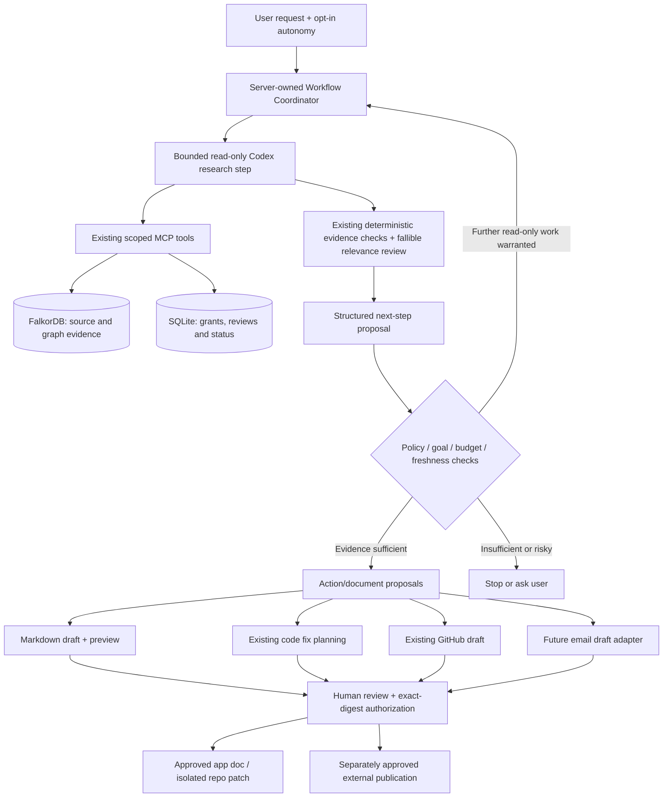

> Implementation note: The baseline proposal below is retained as the design specification.
> The working implementation adds Docs, bounded Auto-investigate workflows and separately
> reviewed connector drafts. See [the usage and validation guide](documentation-workflows.md)
> for current behavior and limitations. The historical `docs/implementation.md` is unchanged.

# Bigyahu Brain — Documentation Authoring and Evidence-Driven Agent Orchestration

**Status:** Proposed implementation plan, not implemented code.
**Reviewed baseline:** `Abhigyan-Shekhar/bigyahu-brain`, `master` tree `2e74abaa2b78bf85fbba85d5fc95c8c7bee26826` (18 October 2026).
**Suggested repository location:** `docs/agent-documentation-and-orchestration.md`. **Do not overwrite** the existing `docs/implementation.md`, which labels itself a historical v3.0 guide.
**Objective:** Extend the current trusted-local-operator Company Brain application so it can (1) author useful source-grounded `.md` documents and (2) decide and execute bounded next *read-only* investigation steps based on checked evidence, while retaining explicit human authorization for durable/external effects.

## 1. Architecture assessment: what exists today

The current product is a **React UI / FastAPI backend / Codex subprocess** architecture, with **FalkorDB** for indexed company and projected memory graphs, and **SQLite** for durable application objects and memory permissions/reviews. It is not yet a hosted multi-user SaaS. The app's server owns identity, workflow state and approval, not the Codex model.

| Current module | Confirmed responsibility | Reuse for this project |
|---|---|---|
| `src/brain/app/agent.py` | Bounded, ephemeral, read-only Codex investigation; checked claims followed by fallible relevance review | Agent-generated next-step research and doc research |
| `src/brain/app/mcp.py` | Application MCP retrieval tools, evidence handles and local `draft_github_action` | Existing read/search/graph tools; no arbitrary command tool |
| `src/brain/app/evidence.py` | Reopened source-byte, quotation and graph-path validation; evidence reuse | Every factual documentation claim and step rationale |
| `src/brain/app/relevance.py` | Bounded secondary model review; cannot guarantee semantic truth | Review doc assertions and next-step relevance |
| `src/brain/app/retrieval.py` | 20 retrieval calls, 6 context calls, duplicate-call limits per run | Preserve budgets per investigation step; add global workflow budget |
| `src/brain/app/actions.py` | Evidence-backed plan, validated files/tests, digest-bound human approval, isolated code edit/test/patch replay | Reuse editor/patch mechanics where appropriate; do not weaken code gates |
| `src/brain/app/action_mcp.py` | `read_file`/`write_file` only within pre-approved isolated checkout, file digest checking | Repository Markdown patch export |
| `src/brain/app/github_actions.py` | `gh`-authenticated issue / draft PR / comment drafts and separately reviewed publication | Draft follow-up issues and PR descriptions; no automatic publish |
| `src/brain/app/sources.py` | Public repository onboarding and separately uploaded text/binary documents | Optional reviewed ingestion of finalized generated docs |
| `src/brain/ingest/documents.py` | Repository document extraction / graph representation | Re-index after an approved revision or approved app-document ingestion |
| `src/brain/app/state.py` | Durable SQLite-backed generic objects with transition checks | Document draft and orchestration run objects |
| `src/brain/app/server.py` | Loopback FastAPI routes, background jobs, authenticated session, existing run streams | Documentation/orchestration routes and streaming |
| `frontend/src/main.jsx` and `frontend/src/api.js` | App navigation, API use and workspace state | Minimal new Docs UI and agent run controls |
| `frontend/src/AgentRuns.jsx`, `ActionPanel.jsx`, `ActivityStream.jsx` | Action status, review and progress | Render orchestration timeline and documentation proposals |
| Personal/Team memory modules | Reviewed, scoped, optionally graph-projected memories | Accepted lessons are *advisory* sources; proposed docs are not memories or policy |

**Important current constraints:**

1. `.md` is **already** in `PLAN_FILE_SUFFIXES`, and the editor can create new allowed Markdown files in an isolated checkout. This is a reusable capability, **not** a finished documentation feature: `PLAN_SCHEMA` currently requires 1–3 pytest/unittest selections; execution expects those tests and generates a patch, but does not write to the indexed original checkout.
2. `POST /api/repositories/{project}/documents` currently imports operator-supplied Markdown/RST/PDF/DOCX *into the application's indexed evidence*. **That is not a Git repository `docs/` file write.** Do not use it as a shortcut for automatically publishing model-produced prose.
3. The GitHub connector prepares locally reviewed issues, draft PRs and comments. It does not commit or push the code patch. A PR needs an already pushed head branch.
4. The current `agent.py` does not manage a chain of independent reasoning jobs. It allows Codex to choose tools within one bounded investigation, then returns a checked result.
5. No functioning email connector was located in the reviewed `master` tree. Integrate an email adapter later using the *same draft → inspect → approve → send* pattern, once the connector's actual implementation is available.

## 2. Product behavior

### A. Documentation authoring

Users should be able to ask in ordinary language:

- “Document the root cause and fix of this signed-token issue in `docs/incidents/signed-token-validation.md`.”
- “Create a developer guide explaining the authentication flow, citing the functions and decisions involved.”
- “Generate an ADR for the approach we just approved, clearly distinguishing historical facts from the proposed decision.”
- “After fixing the bug, draft a changelog entry and a regression-test explanation.”
- “Update the existing `docs/architecture.md` to reflect only verified current code.”

Support these **document types**: `architecture`, `runbook`, `incident`, `adr`, `api_guide`, `change_summary`, and `custom`. Start with Markdown only; don't expand to PDFs/Docs until the `.md` workflow works end-to-end.

Output is a durable **document draft** in the app with filename, content, source citations, revision, limits and a rendered Markdown preview. Offer two distinct destination actions:

1. **Save to Company Brain Docs**: after user review, store an approved Markdown artifact in the app's local documentation library, then optionally ingest it as a clearly marked **agent-generated, reviewed document** into FalkorDB. This is **not** a Git commit and must never silently create a binding organizational decision.
2. **Prepare repository `docs/` patch**: produce a reviewed, revision-bound patch for a Git-tracked `.md` file using an isolated checkout, with a download/export action. A future explicit apply/commit/push workflow can turn that patch into a branch and PR; the current GitHub connector can draft a PR **after** that branch already exists remotely.

Display the destination clearly: **App Docs** versus **Git repository `docs/`**. Never claim a draft has been committed, pushed, reviewed or indexed unless that action actually occurred.

### B. Evidence-driven self-directed work

Add an **Auto-investigate** mode (opt-in per user request), not an unbounded self-chat. Example:

> User: “Investigate why signed-token validation sometimes crashes, figure out the smallest fix, document your findings, and prepare a GitHub issue.”

The coordinator should be able to:

1. Run an evidence-based investigation.
2. Inspect checked claims and missing information; decide whether another bounded research step is useful.
3. Write the **next task instruction** itself (e.g. “Verify timestamp-conversion handling in `TimestampSigner.unsign` and inspect matching tests”).
4. Dispatch that step to a fresh, read-only Codex worker using checked, current evidence and scoped tools.
5. Continue until its explicit completion criteria are met, it reaches a budget, or it needs human input.
6. Produce a **proposed** fix action, document draft, GitHub issue/comment/PR draft or later an email draft as requested/authorized by the user. Actual edits, external publication and messages still require appropriate review/approval.

The LLM proposes the next task; **server code decides whether it is authorized, relevant, fresh and within budget**. The model must never grant itself new tools or permissions by writing a prompt.

## 3. Proposed architecture



**Boundary:** no general `shell`, network/browser or editing capabilities are added to the read-only investigation workers. Write capabilities remain in dedicated constrained modules. The original indexed checkout is not a workspace for model writes.

## 4. Design: Documentation Agent

### 4.1 New files

- `src/brain/app/documentation.py`: generation job, schema, checked-claim verification, doc quality checks and storage lifecycle.
- `src/brain/app/document_store.py`: immutable content-addressed Markdown draft/approved artifact store, normalized metadata and exact-digest transitions.
- `src/brain/app/document_patch.py`: target-path validation and integration with existing isolated editor/replay logic for repository patches; avoid copying the entire editor/test pipeline.
- `frontend/src/DocumentationPanel.jsx`: document list, create form, evidence inspector, Markdown/diff preview and review actions.
- `tests/test_documentation.py`, `tests/test_document_patch.py`: scoped tests.
- Extend `src/brain/app/server.py`, `frontend/src/api.js`, `frontend/src/main.jsx`, and relevant run presentation components.

### 4.2 Suggested generation request

```json
{
  "project": "<server-selected project>",
  "kind": "incident",
  "instruction": "Document the root cause, fix and remaining validation gaps",
  "destination": "app_docs",
  "proposed_repo_path": "docs/incidents/signed-token-validation.md",
  "source_turn_id": "<optional existing turn>",
  "source_action_id": "<optional completed action>"
}
```

`project`, `source_turn_id` and `source_action_id` must be server-verified as belonging to the same selected repository and allowed scope. An absent action ID must not be replaced by an invented completed fix.

### 4.3 Structured Codex output

```json
{
  "title": "Signed-token validation crash",
  "kind": "incident",
  "proposed_repo_path": "docs/incidents/signed-token-validation.md",
  "markdown": "# Signed-token validation crash\n...",
  "claims": [
    {
      "text": "Timestamp conversion may escape without normalization",
      "support": [{"evidence_id": "<issued-by-tool>", "quote": "<exact-source-quote>"}]
    }
  ],
  "limitations": ["Independent behavior verification is not recorded"],
  "suggested_next_actions": ["Add an extreme timestamp regression case"]
}
```

Validate strict keys, lengths, source IDs, literal quotes and paths. Reuse `verified_claims` or an adapter for its expected shape; **never trust model-supplied evidence IDs alone**. The rendered Markdown must identify source citations near factual assertions. An additional model relevance review can find unsupported statements but remains fallible; no claims of guaranteed truth.

### 4.4 Document generation stages

1. **Acquire current evidence.** Reopen source turn/action citations, check graph provenance and repository revision, and retrieve necessary additional context through the existing MCP. Constrain to accepted/authorized memories and current sources.
2. **Generate Markdown.** A fresh read-only Codex process emits structured text plus evidence references. No file writes at this stage.
3. **Validate.** Enforce Markdown byte limit (e.g. 60 KiB), approved document kind, path, citation coverage, link/path validity, forbidden file scope and no uncontrolled HTML/scripts/embedded secrets. Static checks should be deterministic; model support review is additional and fallible.
4. **Persist as draft.** Store content under an immutable digest and create a `documentation_draft` SQLite object with `status=draft`, source revision, provenance and generation parameters. Never overwrite an approved document silently.
5. **Human review.** Show rendered Markdown, exact provenance, unknowns, proposed target path and version diff where applicable. Offer edit/revise while invalidating previous review digest.
6. **Approve destination.** Use exact-digest state transition. For App Docs, approve and optionally ingest a distinct reviewed source with `source_kind=agent_generated_document`, never as binding policy. For repository docs, create a version-bound patch in a disposable checkout and make it downloadable; later branch/PR delivery is separately reviewed.
7. **Staleness.** A newer indexed revision or changed source invalidates publication/apply authorization; keep the historical draft visible with a stale marker.

**Path policy:** allow `docs/**/*.md` for automatic suggestions. Permit `README.md` or other explicitly selected `.md` files only when the user chooses them. Reject absolute paths, dot segments, symlinks, case/path collisions, `.github/`, secrets/config, non-Markdown extensions and content over bounds. Keep path handling consistent with `action_mcp.target` and existing patch replay.

**Document validation is not code-test validation.** Introduce a `documentation` action kind with deterministic Markdown checks and optional existing tests; do not quietly weaken `PLAN_SCHEMA` test requirements for normal code-fix actions.

### 4.5 Source-of-truth clarification

- `docs/foo.md` in the tracked Git repo is **not** the same artifact as an uploaded document or an App Docs draft.
- App Docs can be indexed only after explicit review; the graph records provenance and a marker that this is generated content. Avoid promoting a generated description into a new independent factual authority and then citing it recursively.
- Git-tracked documentation is indexed when the repository's approved/synchronized revision becomes current, not just because the model generated a patch.
- Don't silently write directly into a managed indexed checkout: it would violate revision/snapshot and approval assumptions.

## 5. Design: Evidence-driven autonomous coordinator

### 5.1 New files

- `src/brain/app/orchestrator.py`: durable workflow state machine, budgets, transitions and stop conditions.
- `src/brain/app/next_step.py`: structured next-step proposal schema and validation against checked current evidence.
- `src/brain/app/workflow_policy.py`: allowed capabilities by origin (user request vs source text), publication gates, goal/budget constraints.
- `tests/test_orchestrator.py`, `tests/test_next_step.py`, `tests/test_workflow_policy.py`.
- Extend `agent.py` via a thin read-only step runner (do not recursively invoke user-turn endpoints); extend `server.py`, `activity.py` and frontend Agent Runs.

### 5.2 State and schema

Create `workflow` and `workflow_step` SQLite objects using `State.create`, with explicit parent/owner IDs, status and transitions. Suggested fields:

```json
{
  "workflow_id": "<server ID>",
  "goal": "Investigate issue and draft documentation",
  "user_authorized_capabilities": ["research", "draft_document", "draft_github_issue"],
  "status": "running",
  "source_revision": "<checked SHA>",
  "limits": {"max_steps": 4, "max_model_calls": 8, "max_wall_seconds": 900},
  "steps": ["<immutable child step IDs>"],
  "result": null
}
```

Require a separate **step proposal** shape:

```json
{
  "objective": "Examine signed-token expiration conversion edge cases",
  "kind": "research",
  "rationale": "The current checked finding does not establish behavior for extreme timestamps",
  "based_on_evidence_ids": ["<current checked evidence ID>"],
  "required_tools": ["read_code", "search_code", "get_context"],
  "completion_criteria": ["Identify guarded conversion paths and cite exact lines"],
  "expected_output": "checked_claims",
  "stop_if": ["current source becomes stale", "same evidence gap recurs"]
}
```

Only `kind` values on a server allowlist may execute: initially `research`, `draft_document`, `propose_fix`, `draft_github_issue`, `ask_user`. Other tool/action kinds are rejected. Validate `required_tools` against the capabilities given by the user AND by server policy; never treat model output as authorization.

### 5.3 Execution loop

```python
# Pseudocode only; not implementation-ready imports.
workflow = create_workflow(user_goal, approved_capabilities, revision, budgets)
while workflow.can_continue():
    checked_context = revalidate_previous_evidence(workflow)
    proposal = model_suggest_next_step(goal=workflow.goal,
                                       evidence=checked_context,
                                       completed=workflow.step_summaries)
    step = policy_check(proposal, user_goal=workflow.goal,
                        current_revision=revision,
                        budget=workflow.remaining_budget)
    if step.kind == "ask_user" or step.is_blocked:
        stop_and_surface_reason(workflow, step)
        break
    result = execute_scoped_step_with_fresh_codex(step)
    validate_and_record_result(result)
    if result.completion_criteria_met:
        break
summarize_checked_results_and_proposals(workflow)
```

**Critical:** do not call `POST /api/sessions/{session}/turns` internally to simulate the user, append model-authored text to user messages, or grant new authorization. Each step is a server-owned child object and a fresh ephemeral process. Continue to use scoped, read-only MCP and bounded evidence handles. A child may reference earlier checked evidence only after current source/access validation.

### 5.4 Limits and guardrails

- Start with **max four steps**, at most **eight model calls total**, a **15-minute wall-clock bound**, and conservative aggregate retrieval/token/usage limits; maintain the existing per-run limits and count expensive relevance checks toward the global budget.
- De-duplicate task goals (normalized objective + kind + evidence hash). Refuse identical or near-identical follow-up steps without newly relevant evidence. Limit repair attempts and stop on repeated uncertainty.
- Recheck permissions, source digest, graph path and current revision between steps. Stop if repo identity or document source changed; do not silently fall back to unrelated memories.
- User-requested scope is fixed. A tool result, GitHub issue, retrieved Markdown or email body cannot expand it. Treat every retrieved artifact as **untrusted data**, never an instruction to schedule more actions.
- For reads, the coordinator may proceed unattended **within the opted-in budget**. For file changes, GitHub publication, email sending, grant changes, memory approval, merges/deployments or commit/push, retain a separate exact-content/target authorization event.
- A model's suggestion to create an issue/email/doc is a **proposal** unless the user explicitly authorized that action category. Even then, publication is another approval.
- Every step should record the prompt digest, parent evidence IDs, model requested, allowed tools, status, cost/time if genuinely measured, validation results and stopping reason. Provide UI stop/cancel; terminating a worker must not mutate the original checkout.

### 5.5 Frontend behavior

In **Ask Brain**, add one compact option: `Auto-investigate (up to 4 steps)` with a clear disclosure that it performs additional read-only research and may prepare **drafts** but not publish anything. Keep it off by default.

In **Agent Runs**, show a clear, real timeline:

- **Step 1 — Locate failure path:** completed; 3 checked sources.
- **Step 2 — Inspect tests and history:** completed; 2 checked sources.
- **Step 3 — Draft fix plan:** prepared, awaiting approval.
- **Step 4 — Write incident documentation:** proposed draft, awaiting review.

Display actual steps only. Each row expands to verified sources, why the step was necessary, limitations and the next transition. Do not show invented chain-of-thought or fake tool events. Add **Stop**, **Review drafts** and **Resume after approval** actions when valid.

## 6. Cross-connector workflow

Integrate **GitHub and future email** through a shared `draft_action` concept (a protocol, not an unbounded generic tool with direct send privileges):

| Action | Agent can prepare automatically in opted-in workflow? | Requires separate human action? |
|---|---|---|
| Read graph/code/docs and evaluate hypotheses | Yes, within limits | No additional approval after opt-in |
| Write a Markdown draft in app storage | Yes | Review before promotion to approved Docs / repository patch |
| Propose code fix plan | Yes | Approve before isolated editing |
| Edit isolated approved code/doc patch | Only with existing exact approval | Yes |
| Create GitHub issue/comment/PR draft | Yes **only if user-authorized** | Publish requires review |
| Commit/push branch | Not currently implemented | Must be separately designed and approved |
| Send email | Not implemented in reviewed branch | Draft, inspect recipients/body, then explicit send approval |
| Accept/share memory | Proposal only | Existing reviewer grants and decisions |

For email: keep address verification, subject/recipient/content inspection, attachment visibility and unknown-outcome/idempotency handling in the connector; don't infer recipients from arbitrary docs and send automatically. Do not let a GitHub comment or email become a command to the coordinator.

**Suggested compound UX:** “Investigate → Prepare fix → Draft incident documentation → Prepare GitHub issue → Prepare email summary.” The run ends with a **review queue**. The user can approve each independent external/durable action, with exact target/payload diff.

## 7. API contracts (proposed, not existing)

```text
POST /api/repositories/{project}/documentation/drafts
GET  /api/repositories/{project}/documentation/drafts
GET  /api/repositories/{project}/documentation/drafts/{id}
POST /api/repositories/{project}/documentation/drafts/{id}/revise
POST /api/repositories/{project}/documentation/drafts/{id}/approve
GET  /api/repositories/{project}/documentation/drafts/{id}/download
POST /api/repositories/{project}/documentation/drafts/{id}/prepare-patch
POST /api/repositories/{project}/documentation/drafts/{id}/index-approved

POST /api/repositories/{project}/workflows
GET  /api/repositories/{project}/workflows
GET  /api/repositories/{project}/workflows/{id}
GET  /api/repositories/{project}/workflows/{id}/events
POST /api/repositories/{project}/workflows/{id}/stop
POST /api/repositories/{project}/workflows/{id}/resume
```

Use the existing project/session authentication, single-operator boundary, ThreadPoolExecutor patterns, SSE snapshots and `State.transition`. Preserve JSON status visibility after refresh. Approve endpoints must carry an expected digest/revision; check it on the server. Do not rely on button disablement for security.

## 8. Test plan — required before calling either feature complete

### Documentation tests

1. A checked source-backed finding becomes a Markdown draft with correct source references and a stable artifact digest.
2. A fabricated evidence ID, wrong quotation, stale source or unauthorized memory blocks factual publication.
3. Doc-only generation works **without** dummy Python tests; normal code-fix plans still require the existing test runner selections.
4. New file and existing file edits under `docs/**/*.md` generate valid patches; byte-identical fresh-base replay succeeds including final newline and CRLF handling.
5. Paths outside the allowed root, symlinks, traversal, `.github`, secrets, oversized Markdown and stale approvals fail closed.
6. Draft editing invalidates prior approval. Duplicate approval/publish attempts are idempotent or explicitly rejected as appropriate.
7. App Docs ingestion only occurs after review, uses generated-document provenance, and does not transform draft prose into independent trusted policy.
8. A repo patch remains *uncommitted and unapplied* until a separately approved branch/apply flow actually exists.

### Autonomous workflow tests

1. Starting a workflow launches research tasks only under the selected repo/principal and server-allowed tools.
2. Model-proposed task instructions cannot grant shell, write, publication, email, memory review or arbitrary repo access.
3. Prompt injection embedded in a README, GitHub comment, retrieved issue, uploaded document or memory text is treated as content; it cannot schedule an unauthorized task.
4. Four-step/model-call/wall-clock/retrieval budgets stop the loop and show a truthful partial outcome.
5. Duplicate next steps, evidence-free tasks and unsupported conclusions stop or ask for clarification.
6. Parent evidence ID changes, expired permission, changed revision and changed source digests halt dependent children.
7. Worker failure, process timeout, server restart and user cancellation persist a correct resumable-or-stopped state; no duplicate external mutation.
8. Agent-drafted GitHub issue stays a draft; existing `github_actions.publish` exact-consent checks still gate writing.
9. Code edit runs remain isolated and human-approved; existing original-vs-patched and patch-replay regressions remain green.
10. A docs draft does not become new trusted evidence that the next step then quotes as proof of its own claim.

**Regression requirement:** run focused new tests plus `tests/test_app_actions.py`, `tests/test_plan_relevance.py`, `tests/test_github_actions.py`, `tests/test_app_investigation.py`, `tests/test_chat_knowledge_workflow.py`, memory permission/review tests, and the repo's documented full validation, frontend tests/build, Ruff and publication scan. Record real commands/results; do not invent passing counts.

## 9. Implementation order and acceptance criteria

### Phase 1 (P0) — Markdown document drafts

1. Implement `documentation.py` + durable draft store with provenance, strict output schema and citation verification.
2. Build simple Docs panel with generate, preview, inspect evidence, edit, approve and download `.md`.
3. Add `Create documentation` after a completed investigation or patch run, prefilled with the **actual** run ID and verified findings.
4. Build repository `docs/` patch export via existing isolated editor/replay logic; preserve code-fix approval/test behavior unchanged.
5. Only after review, provide optional App Docs ingestion using generated-source metadata.

**Done when:** a user can say “write the incident report,” inspect what backs each key factual statement, and download an actual `.md` or an approved `docs/` patch without falsely claiming it reached GitHub.

### Phase 2 (P1) — Self-prompting research

1. Implement workflow/step state records and deterministic policy.
2. Add structured, checked next-step generation; reuse Codex read tools and evidence validator per step.
3. Add budget, duplicate task detection, prompt-injection isolation, cancel/resume and auditable stage timeline.
4. Allow the coordinator to call Phase 1 generation and existing fix planning as **proposals** within explicitly user-authorized scope.

**Done when:** one user's high-level objective leads to multiple useful, validated research steps selected by the agent, with visible reasons and no new user prompts required, while stopping at every durable/external authorization boundary.

### Phase 3 (P2) — Reviewed connector composition

1. Connect opted-in workflows to existing `draft_github_action` for issue/comment/PR drafts, preserving exact review before publish.
2. Once email connector is committed and verified, add `draft_email` to the same structured proposal queue with recipient/subject/body review and separate send.
3. Only if time permits, add a separate approved patch-to-branch/push flow; do **not** fake that capability through the current PR draft API.
4. Add end-to-end tests/demo for “investigate → propose fix → document → GitHub draft → email draft,” showing where human approval happens.

**Done when:** all actions are clearly labeled *drafted*, *awaiting approval*, *executed*, *published* or *outcome unknown*, based on real results.

## 10. Demo story

**Prompt:** “Why does signed-token validation throw an unexpected exception? Investigate it using company knowledge, prepare the smallest fix, document what you learned, and draft a GitHub issue for follow-up.”

Show:

1. Agent selects the next evidence queries and exposes actual FalkorDB source paths.
2. Read-only follow-up step is auto-generated to check edge cases and historical evidence.
3. A supported fix plan appears; user approves isolated editing.
4. Existing tests display baseline vs patched outcomes; independent verification status is disclosed separately.
5. Incident `.md` draft appears, with checked citations, a `docs/` target and preview/diff.
6. GitHub issue is **drafted**, and requires a separate publication review.
7. The agent offers a next-step suggestion based on verified observations, not on unsupported speculation.

**Narrative:** “Company Brain doesn't stop at finding answers. It follows evidence, coordinates the next investigation, drafts the fix and its documentation, and hands off reviewed actions with provenance.”

## 11. Explicit non-goals for this change

- No unrestricted recursive self-prompt loops.
- No autonomous public GitHub posts, email sends, merges, commits, pushes or deployments.
- No editing of the original indexed checkout without a separate revision-safe apply workflow.
- No treating generated Markdown or a proposed personal/team memory as automatically approved company policy.
- No new hosted auth, arbitrary connector federation or major frontend redesign.
- No claimed performance improvement from FalkorDB without a controlled comparison.

## 12. First implementation prompt to give the coding agent

> Study current `src/brain/app/{agent,mcp,evidence,relevance,actions,action_mcp,sources,github_actions,state,server}.py`, `frontend/src/{main.jsx,api.js,ActionPanel.jsx,AgentRuns.jsx}`, and their relevant tests. Implement **Phase 1 only** from this specification. Preserve existing code plan/test/approval gates, current GitHub draft/publish semantics, revision-bound citation checks and original indexed checkout immutability. Prefer reusing the constrained editor and content-addressed storage. Add source-grounded Markdown draft generation, review/approval, `.md` download, and a valid isolated `docs/` patch, then prove with focused and existing regression tests. Report exactly what works and what remains unimplemented. Do not add arbitrary shell/network tools or bypass approvals. Do not substantially redesign the UI.

---

**Bottom line:** Implement **documentation drafts first**, then **bounded self-directed investigation**, and finally connector composition. The most important architectural principle is **agent autonomy over thought and read-only research, server authority over permissions, files and external side effects**.
