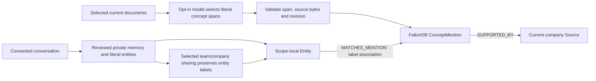

# Source-grounded company concept mentions

Conversation entity labels can now lead to company documents without a shared
company citation or an explicit code identifier. This path matches named mentions;
it does not infer that two concepts have the same identity or meaning.



## Operator ingestion

First index the clean checkout and its Markdown/RST documents with the existing
`sync` and `ingest-docs` commands. Inspect the current document UIDs, then explicitly
select up to twenty for model annotation:

```sh
python -m brain annotate-concepts \
  --document 'REPOSITORY@REVISION:path.md:section:L1-L10' \
  --model gpt-6.1-sol
```

Repeat `--document` for additional selected sections. This command uses the
existing `BRAIN_CONFIG`. It sends only the selected document UIDs/text to the named
Codex model using the same isolated structured extractor as conversation import.
It consumes account model usage and is not local-model inference. It does not
read private conversations or the memory catalog. There is no background model
call, default model selection or new MCP mutation tool.

A selected document must be current at the completed repository revision, have
one unambiguous native Source, and match that source's complete bytes and digest.
Symlink/path/dirty-checkout controls remain in upstream document ingestion. Model
output selects salient engineering policies, mechanisms and concepts as literal
Unicode spans; invented names, aliases, unknown documents, invalid offsets and
duplicate labels per document are rejected before mutation. Limits are 60,000
selected characters, 200 mentions and 100,000 annotation characters per document.
The operator's explicit command selects the source data and model destination;
conversation imports retain their separate exact-digest consent requirement.

FalkorDB stores per-document `ConceptMention` nodes, `MENTIONS_CONCEPT` edges and
`SUPPORTED_BY` links. These are advisory annotations over existing text, comparable
to parser metadata; they are not reviewed memory facts, decisions or constraints.
A readiness flag blocks company reads during mutation. Interrupted writes stay
unavailable until a successful explicit rerun; retry ignores only its own prior
concept flag and still respects code/document/GitHub/Graphify readiness fences.

## Retrieval and sharing

Refresh each affected authorized memory projection with `sync-graph --include-company`.
Then request `memory_graph(include_company=true)` or native
`memory_search(..., include_graph=true)` using the existing selected brains.
Current company access is required before company graph I/O. Default views omit
all company proxies. No read triggers model extraction or graph mutation.

For every read, the bridge checks the mention against the document's recorded
annotation, exact span, current native relationships, Source bytes, source digest
and revision. Missing native source edges, retired documents, changed source
bytes or tampered spans cannot yield a concept proxy. Invalid evidence is omitted
and diagnosed; incomplete projections still require refresh.

Labels use Unicode case folding and whitespace normalization. Matches produce
`MATCHES_MENTION` associations with explicit non-identity metadata; separate
same-label document mentions remain separate cited contexts. Synonyms and aliases
are not invented. The bridge does not select one meaning for an ambiguous label.
At most 100 candidate mentions are accepted per requested view; overflow fails
closed. Existing eligible-view, frontier and evidence-output bounds still apply.

Selected sharing now preserves only the selected record's hash-matched, literal
entity labels as local advisory metadata. The destination record is still a
proposal requiring its existing review. Private records and unselected annotations
are not shared. `.abhi/2` semantic annotation portability remains unimplemented.
The default company tools retain their existing document/source behavior; concept
proxies are exposed through the authorization-aware native memory interface.

## Evidence

The [guided named-concept agent run](company-concept-agent-verification.json)
uses real model extraction for both a synthetic company policy and a consented
personal decision. No company citation is attached to the personal memory, and
that memory contains no explicit code identifier. After synthetic-only reviews
and selected team/company sharing, a fresh Codex process follows the named concept
to source-checked policy evidence before editing. The independent verifier checks
15 oracle cases, agent regression tests, source citation, unchanged policy and
exclusion of another developer's private canary. The original fixture fails the
same oracle. Raw traces, database state and selected input/model output stay local.

An initial setup attempt selected the API/error names `retry.delay_ms` and
`ValueError` but omitted the policy label `backoff envelope`. Clarifying the generic
prompt to include named policies/mechanisms produced the needed literal mention.
The successful run is a guided synthetic acceptance demonstration after that
prompt change, not a general extraction-accuracy or coding-improvement benchmark.
Source/runner hashes in the report identify the implementation used for that run.

## Prepare before presenting

Literal-span validation checks the evidence for returned mentions; it cannot
guarantee selection recall. For the hackathon, prepare and inspect the synthetic
fixture ahead of time, then present using those validated annotations:

```sh
PYTHONPATH=src .venv/bin/python scripts/demo_company_concepts.py \
  --prepare-only --model gpt-6.1-sol \
  --output data/validation/prepared-concept-demo.json
# Use the prepared_run directory printed above/in the JSON report:
PYTHONPATH=src .venv/bin/python scripts/demo_company_concepts.py \
  --prepared-run /ABSOLUTE/PATH/TO/PREPARED/RUN --model gpt-6.1-sol \
  --output data/validation/presented-concept-demo.json
```

Preparation performs real document/conversation extraction and the synthetic-only
reviews/sharing, requires the policy label and a valid company mention path, then
stops the disposable engine with SAVE. It seals the checkout, SQLite catalog,
FalkorDB RDB and append-only files, config and annotation/preflight records with
SHA-256 hashes.
Inspect `selected-document-concepts.json` and `operator-preflight.json` before the
presentation. These hashes detect changes; they are not origin authentication.

Presentation validates the seal, copies the prepared fixture into a fresh local
run, starts a separate engine from the saved snapshot, and rereads the authorized
graph through current source/span/permission checks. The result must match the
preparation's graph before the coding agent starts. It performs no ingestion,
semantic extraction or reviews, and does not modify the original preparation.
The selected model is still used for the live coding agent. Repeat presentation
runs start from the original buggy fixture; a changed preparation fails closed.
All snapshots and raw records remain ignored under `data/validation`.

The [prepared presentation verification](prepared-concept-agent-verification.json)
records a real agent run using saved annotations: 15 independent oracle cases and
6 agent tests passed, the source was consumed before edits, and the private canary
was excluded. The first restore attempt omitted Lite's append-only files and was
rejected as incomplete before starting the agent. Including and sealing those
files fixed restoration; the original preparation remained unchanged during the
successful presentation. This demonstrates the prepared workflow, not semantic
extraction completeness or universal Graphify/memory relationship integration.

Reproduce the full model/agent fixture, or recheck a retained run without model calls:

```sh
PYTHONPATH=src .venv/bin/python scripts/demo_company_concepts.py \
  --model gpt-6.1-sol --output /ABSOLUTE/PATH/concept-verification.json
PYTHONPATH=src .venv/bin/python scripts/demo_company_concepts.py \
  --verify-run /ABSOLUTE/PATH/TO/RETAINED/RUN \
  --output /ABSOLUTE/PATH/rechecked-verification.json
```

The full disposable Lite suite now passes **287 tests**. New coverage includes
literal span validation, no model egress for missing documents, native source
edge/byte/span rechecking, retirement, interrupted-write recovery, independent
team retrieval after selected sharing, UTF-8 structured output and existing
permission boundaries, explicit rejection of non-UTF-8 Graphify input, and sealed
fixture tamper checks for catalog, RDB, append-only and checkout files. Ruff and
publication checks are run before committing.

This Company Brain model annotation path is distinct from Graphify's structural
adapter. Graphify's own semantic backend, PDF/FalkorDB GraphRAG SDK ingestion,
arbitrary semantic identity resolution, hosted identity and enterprise-scale
validation remain future work.
